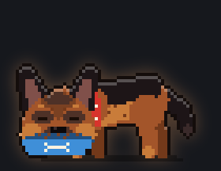
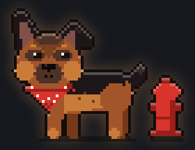
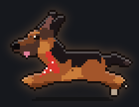

# Keloqz 🐕

Un pastor alemán en pixel art que vive encima de todas tus ventanas del Mac, como la mascota de
Codex. Te enseña qué hace cada sesión de Claude Code que tengas abierta y te avisa con un
**¡Saltado!** cuando una termina, en lugar del banner de macOS de Lomo-Saltado.

<p align="center"></p>

### Los cuatro estados

| Esperando | Trabajando | ¡Saltado! | Durmiendo |
| :---: | :---: | :---: | :---: |
|  |  |  |  |
| sin nada cocinando | mientras alguna sesión trabaja | cuando una sesión termina | tras 5 minutos de calma |

### Trucos

| Comer | Hacer pis | Correr |
| :---: | :---: | :---: |
|  |  |  |
| 20 s, tras 20 s de pelota | 20 s, justo después de comer | mientras lo arrastras, mirando hacia donde va |

Su rutina, trabaje algo o no: 20 s jugando a la pelota (o sentado), 20 s comiendo, 20 s haciendo
pis, y vuelta a empezar. También puedes pedirle cada truco con clic derecho → Trucos (dura 20 s).

- **Burbuja:** el último aviso, o lo que está cocinando la sesión más reciente.
  Pasa el ratón por encima y pulsa ✕ para borrarla (borra también los avisos en cola).
- **Número en el hombro:** cuántas sesiones están cocinando. Punto rojo: aviso sin ver.
- **Poses:** juega con la pelota mientras algo cocina (con sus descansos para comer y hacer pis), salta al terminar, se sienta cuando no
  hay nada y se tumba a dormir tras 5 minutos de calma.
- **Clic en Keloqz:** lista de sesiones; clic en una fila y te lleva a su pestaña de Terminal.
- **Al pasar el ratón:** 🐾 sesiones · ＋ nueva sesión de Claude en una carpeta · 🔕 silenciar ·
  – minimizar.
- **Minimizado:** Keloqz se esconde en la barra de menús (🐾 y cuántas sesiones cocinan); clic
  para traerlo de vuelta (o vuelve a abrir Keloqz desde Aplicaciones o Spotlight). Mientras tanto vuelven los banners de Lomo-Saltado.
- **Clic derecho:** Silenciar · Tamaño S/M/L · Trucos · Minimizar · Abrir al iniciar sesión · Salir de Keloqz.

## Compilar e instalar

Solo hacen falta las Command Line Tools (sin Xcode) y Node.

```bash
scripts/build.sh --install   # compila, instala en /Applications y lo abre
scripts/test.sh              # tests de Swift y de los sprites
```

La compilación se hace en `~/Library/Caches/Keloqz`, no dentro del repo: esta carpeta está en
`~/Documents`, que iCloud sincroniza, e iCloud marca los archivos de una forma que impide firmar
la app.

## Cómo sabe lo que pasa

- `~/.claude/sessions/<pid>.json` — lo escribe Claude Code: qué sesiones hay y si están ocupadas.
- `~/.claude/saltado/cocina/<sesión>.json` — lo escribe Lomo-Saltado: qué pediste, qué hace
  ahora, cuándo empezó y acabó el turno, errores.
- `~/.claude/saltado/keloqz.json` — lo escribe Keloqz cada 10 s. Mientras sea reciente,
  Lomo-Saltado no manda su banner; si cierras Keloqz, los banners vuelven solos.

## Cambiar el dibujo

El perro se dibuja con código en `art/keloqz.js`. Para verlo animado:

```bash
python3 -m http.server -d art 8765    # y abre http://localhost:8765/preview.html
node tools/render-sprites.mjs         # regenera los PNG que usa la app
python3 tools/readme-gifs.py          # regenera los GIF de este README (necesita Pillow)
scripts/build.sh --install
```

## Para probar sin tocar tus sesiones

`KELOQZ_CLAUDE_DIR=/una/carpeta /Applications/Keloqz.app/Contents/MacOS/Keloqz` hace que una
copia lea sesiones falsas de esa carpeta en lugar de `~/.claude`.
